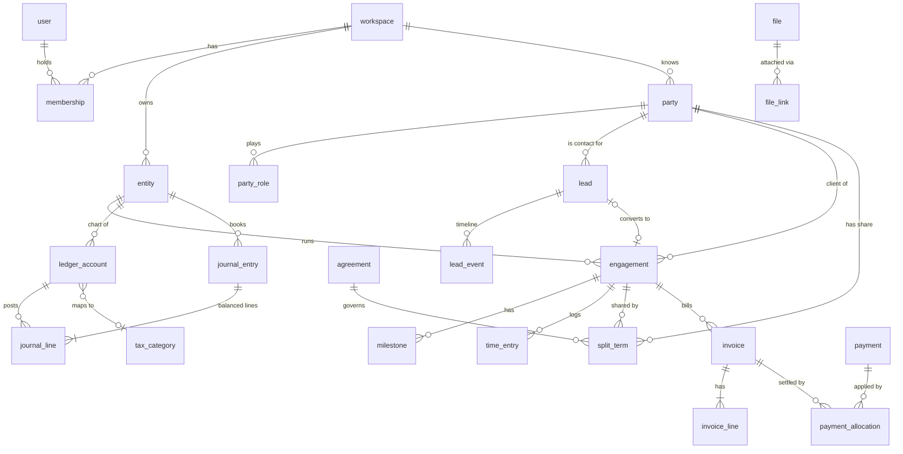

# Studio tools: data model

The entities, how they relate, and how money and time are represented. Table and column names are
the planned ones; the schema itself lands release by release, one migration at a time.

## Conventions

- **Primary keys** are UUIDs (version 7, which sort by creation time). An attacker cannot guess a
  neighbouring record's id the way they could with 1, 2, 3. That is not a security control on its
  own (every query is still authorised), but it removes an easy probe.
- **Every business table carries `workspace_id`.** The workspace is the authorisation boundary:
  every query filters by it. There is one workspace today.
- **Books belong to an entity.** Ledger tables also carry `entity_id`, because a sole proprietor
  and a later company keep separate books.
- **Money** is an integer count of minor units (cents) in a `bigint` column, next to a three-letter
  currency code. Never a float, never a decimal string in application code.
- **Percentages** are integer **basis points**: 10,000 is 100%, 2,500 is 25%.
- **Durations** are integer minutes.
- **Instants** (when something happened) are `timestamptz`. **Calendar dates** (the day work was
  done, an invoice date, a due date) are `date`. A tax year is made of calendar dates; storing them
  as instants would move a late-evening entry into the next day, or the next year, depending on
  the time zone of whoever reads it.
- **Effective dating.** Anything that changes over time and matters for history (rates, split
  terms, settings, tax parameters) is a row with `effective_from` and `effective_to`. The old row
  is closed and a new one added; nothing is overwritten.
- **Snapshots.** A value that was true when a record was made (the hourly rate on a time entry)
  is copied onto the record.
- **Append-only where history matters.** Journal entries, audit events and timeline events are
  never updated or deleted; the database refuses it.
- **Constraints live in the database** (not null, foreign keys, check constraints, unique
  indexes), not only in application code. The application validates for good error messages; the
  database guarantees the rule holds no matter which code path wrote the row.

## Overview

## Identity and tenancy (Foundations)

| Table                                                   | Purpose                                                                                                                                                                                                                                             |
| ------------------------------------------------------- | --------------------------------------------------------------------------------------------------------------------------------------------------------------------------------------------------------------------------------------------------- |
| `workspace`                                             | The authorisation boundary. One row today.                                                                                                                                                                                                          |
| `user`, `session`, `account`, `verification`, `passkey` | Owned by the sign-in library. Sessions are rows, so they can be listed and revoked.                                                                                                                                                                 |
| `membership`                                            | Links a user to a workspace with a `role`: `owner` now; `partner_viewer` later, with the `party_id` whose statements that user may see.                                                                                                             |
| `entity`                                                | A legal entity that keeps books: `legal_name`, `kind` (sole proprietor, single-member company, multi-member company), `accounting_basis` (cash or accrual), `base_currency`, `fiscal_year_start_month`, `formed_on`, `dissolved_on`. One row today. |
| `setting`                                               | Key, JSON value, `effective_from`, `effective_to`. Holds what is specific to the owner: default rates, lead retention, tax jurisdiction details, tax parameters per year, reporting thresholds.                                                     |
| `audit_event`                                           | Who did what to which record, when. See [security](security.md).                                                                                                                                                                                    |

## People and organisations (Release 1)

One `party` table for every person or organisation the studio deals with, instead of separate
client, partner and vendor tables. The same company can be a client this year and a partner next
year; with one table that is a second role, not a duplicate record.

| Table           | Columns of note                                                                                                                 |
| --------------- | ------------------------------------------------------------------------------------------------------------------------------- |
| `party`         | `kind` (person, organisation), `display_name`, `organisation_id` (the organisation a person belongs to), `notes`, `archived_at` |
| `party_role`    | `party_id`, `role` (client, partner, contractor, vendor), unique per pair                                                       |
| `contact_point` | `party_id`, `type` (email, phone, url), `value`, `is_primary`                                                                   |

## Leads (Release 1)

| Table            | Columns of note                                                                                                                                                                                                                                                                                          |
| ---------------- | -------------------------------------------------------------------------------------------------------------------------------------------------------------------------------------------------------------------------------------------------------------------------------------------------------- |
| `lead`           | `party_id` (nullable until the contact is confirmed), `source` (contact form, referral, outreach, other), `stage`, `project_type`, `budget_band`, `timeline`, `details`, `estimated_value_minor`, `currency`, `next_follow_up_on`, `outcome_reason_id`, `closed_on`, `intake_key` (unique), `created_at` |
| `lead_event`     | `lead_id`, `type` (created, stage changed, note, follow-up set, follow-up done), `body`, `from_stage`, `to_stage`, `actor_user_id`, `occurred_at`. Append-only.                                                                                                                                          |
| `outcome_reason` | Editable list of win and loss reasons.                                                                                                                                                                                                                                                                   |
| `outbox`         | Notifications waiting to be sent: `kind`, `payload` (ids only, no personal data), `attempts`, `sent_at`.                                                                                                                                                                                                 |
| `rate_limit`     | `bucket` (a salted hash, never a raw address), `window_start`, `count`.                                                                                                                                                                                                                                  |

- `stage` is one of: new, contacted, qualified, proposal sent, won, lost. A check constraint
  enforces the list, and `outcome_reason_id` and `closed_on` are required when the stage is won or
  lost.
- `intake_key` makes the public write idempotent (see [architecture](architecture.md)).
- The current stage is stored on the lead for fast filtering; the events are the history. Both
  are written in one transaction so they cannot disagree.

## Engagements and time (Release 1)

| Table             | Columns of note                                                                                                                                                                                                                                                            |
| ----------------- | -------------------------------------------------------------------------------------------------------------------------------------------------------------------------------------------------------------------------------------------------------------------------- |
| `engagement`      | `entity_id`, `kind` (client, product, internal), `client_party_id` (required when kind is client), `lead_id`, `name`, `status`, `billing_model` (fixed, hourly, retainer, none), `default_rate_minor`, `budget_minor`, `currency`, `starts_on`, `ends_on`, `scope_summary` |
| `milestone`       | `engagement_id`, `title`, `due_on`, `amount_minor` (optional), `status`, `completed_on`                                                                                                                                                                                    |
| `time_entry`      | `engagement_id`, `worker_party_id`, `worked_on` (date), `minutes`, `billable`, `rate_minor` (snapshot), `description`, `invoice_line_id` (set when billed; the entry is then read-only)                                                                                    |
| `engagement_link` | `title`, `url`: outside documents, until the vault exists.                                                                                                                                                                                                                 |

A side project the owner builds for themselves is an engagement of kind `product` with no client.
That is what lets ownership shares (Release 3) attach to client work and to products in the same
way.

## Money (Release 2)

Described fully in [ADR 0007](../adr/0007-money-and-ledger.md). In short:

| Table                | Purpose                                                                                                                                                                        |
| -------------------- | ------------------------------------------------------------------------------------------------------------------------------------------------------------------------------ |
| `ledger_account`     | The chart of accounts: `code`, `name`, `type` (asset, liability, equity, income, expense), `tax_category_id`, `archived_at`                                                    |
| `journal_entry`      | One balanced transaction: `entity_id`, `entry_date`, `memo`, `source_type`, `source_id`, `idempotency_key` (unique per entity), `reverses_entry_id`, `posted_at`. Append-only. |
| `journal_line`       | `entry_id`, `account_id`, `amount_minor` (debits positive, credits negative), `engagement_id`, `party_id`. Append-only. The lines of an entry sum to zero.                     |
| `expense`            | `vendor_party_id`, `incurred_on`, `amount_minor`, `account_id`, `engagement_id`, `paid_from_account_id`, `business_use_bps`, `receipt_file_id`, `journal_entry_id`             |
| `invoice`            | `number` (unique, sequential per entity), `client_party_id`, `engagement_id`, `issue_date`, `due_date`, `status` (draft, sent, part paid, paid, void), `total_minor`           |
| `invoice_line`       | `description`, `quantity_thousandths`, `unit_price_minor`, `amount_minor`, `income_account_id`                                                                                 |
| `payment`            | `received_on`, `amount_minor`, `method`, `reference`, `deposit_account_id`, `idempotency_key`, `journal_entry_id`                                                              |
| `payment_allocation` | `payment_id`, `invoice_id`, `amount_minor`: one payment can settle several invoices, and one invoice can be settled in parts                                                   |
| `period_lock`        | `entity_id`, `locked_through` (date): nothing dated on or before it can be posted                                                                                              |

The two dimensions on a journal line, `engagement_id` and `party_id`, are what make the reports
fall out of one table: profit per engagement is the sum of income and expense lines for that
engagement, and what a partner is owed is the balance of the payable account for that party.

### Seed chart of accounts

A generic starting chart ships as seed data (it is public reference material, not owner data), and
the owner edits it in the tool.

| Code | Account                        | Type      |
| ---- | ------------------------------ | --------- |
| 1000 | Business bank account          | Asset     |
| 1100 | Accounts receivable            | Asset     |
| 2000 | Partner and contractor payable | Liability |
| 2100 | Tax set-aside                  | Liability |
| 3000 | Owner contributions            | Equity    |
| 3100 | Owner draws                    | Equity    |
| 4000 | Service income                 | Income    |
| 4100 | Product income                 | Income    |
| 5000 | Contract labour                | Expense   |
| 5100 | Software and subscriptions     | Expense   |
| 5200 | Hosting and domains            | Expense   |
| 5300 | Equipment and supplies         | Expense   |
| 5400 | Professional services          | Expense   |
| 5500 | Advertising                    | Expense   |
| 5600 | Travel                         | Expense   |
| 5700 | Meals                          | Expense   |
| 5800 | Insurance                      | Expense   |
| 5900 | Other expenses                 | Expense   |

## Agreements and ownership (Release 3)

Described fully in [ADR 0008](../adr/0008-ownership-and-splits.md).

| Table             | Purpose                                                                                                                                                                                                                                                    |
| ----------------- | ---------------------------------------------------------------------------------------------------------------------------------------------------------------------------------------------------------------------------------------------------------- |
| `agreement`       | `type` (subcontract, profit share, revenue share, equity, statement of work, non-disclosure, master services), `title`, `signed_on`, `effective_from`, `effective_to`, `file_id`                                                                           |
| `agreement_party` | Who signed: `agreement_id`, `party_id`, `signed_on`                                                                                                                                                                                                        |
| `split_term`      | `engagement_id`, `party_id`, `basis` (fixed fee, hourly, profit share, revenue share, equity), `share_bps`, `fixed_minor`, `rate_minor`, `cap_minor`, `priority`, `posts_to_account_id`, `effective_from`, `effective_to`, `agreement_id`, `supersedes_id` |
| `allocation_run`  | One computation for an engagement and a period: inputs, the terms used, the journal entry it posted                                                                                                                                                        |
| `allocation_line` | Each party's amount in a run                                                                                                                                                                                                                               |
| `payout`          | A payment to a partner or contractor: `party_id`, `paid_on`, `amount_minor`, `journal_entry_id`                                                                                                                                                            |

## Tax preparation (Release 4)

| Table          | Purpose                                                                                       |
| -------------- | --------------------------------------------------------------------------------------------- |
| `tax_category` | `jurisdiction`, `form`, `line`, `label`, `deductible_bps`, `valid_from_year`, `valid_to_year` |

Tax categories are data because they change (lines are renumbered, limits move) and differ by
jurisdiction. A seed set for a US sole proprietor's Schedule C ships as public reference data;
which account maps to which category is the owner's choice, stored in the database. Parameters the
estimated-tax helper needs (rates, thresholds, due dates) are `setting` rows per tax year, entered
by the owner.

## Files (Release 2)

| Table       | Purpose                                                                                                                                                         |
| ----------- | --------------------------------------------------------------------------------------------------------------------------------------------------------------- |
| `file`      | `storage_key` (random, not the original name), `sha256`, `size_bytes`, `media_type`, `kind` (receipt, agreement, invoice, other), `uploaded_by`, `retain_until` |
| `file_link` | `file_id`, `subject_type`, `subject_id`: attaches a file to any record                                                                                          |

The database holds the metadata and the storage service holds the bytes. Because sizes are in the
database, the tool can total its own usage and warn long before the storage limit, without asking
the storage service.

## Deleting data

| Kind of record                  | Removal                                                                                                         |
| ------------------------------- | --------------------------------------------------------------------------------------------------------------- |
| Leads and their contact details | Hard delete, by hand or by the retention job. The audit event that records the deletion holds no personal data. |
| Parties, engagements            | Archived (`archived_at`), hidden by default, never orphaning history                                            |
| Time entries                    | Editable until invoiced, then read-only                                                                         |
| Journal entries, audit events   | Never. A mistake is corrected by a reversing entry                                                              |
| Files                           | Deleted only when nothing links to them and `retain_until` has passed                                           |
